<div align="center">

<a href="https://devjhawar.com">
  <picture>
    <source media="(prefers-color-scheme: dark)" srcset="assets/hero-dark.svg" />
    
  </picture>
</a>

<sub>
<a href="https://devjhawar.com">Portfolio</a> &nbsp;/&nbsp;
<a href="https://resume-drab-six.vercel.app">Résumé</a> &nbsp;/&nbsp;
<a href="https://linkedin.com/in/dev-jhawar11">LinkedIn</a> &nbsp;/&nbsp;
<a href="mailto:dev.jhawar.cs@gmail.com">Email</a>
</sub>

</div>

<br/>

<picture>
  <source media="(prefers-color-scheme: dark)" srcset="assets/h-featured-dark.svg" />
  
</picture>

<div align="center">

<a href="https://github.com/DEVJHAWAR11/WatchTower">
  <picture>
    <source media="(prefers-color-scheme: dark)" srcset="assets/card-watchtower-dark.svg" />
    
  </picture>
</a>

<sub><b>WatchTower</b> &nbsp;/&nbsp; <a href="https://watch-tower-seven.vercel.app">live app</a> &nbsp;/&nbsp; <a href="https://github.com/DEVJHAWAR11/WatchTower">source</a> &nbsp;/&nbsp; <a href="https://github.com/DEVJHAWAR11/WatchTower/blob/main/docs/ARCHITECTURE.md">architecture</a></sub>

<br/><br/>

<a href="https://github.com/DEVJHAWAR11/GridMind"><picture><source media="(prefers-color-scheme: dark)" srcset="assets/card-gridmind-dark.svg" /></picture></a>
<a href="https://github.com/arpanz/policylens"><picture><source media="(prefers-color-scheme: dark)" srcset="assets/card-policylens-dark.svg" /></picture></a>

<sub><b>GridMind</b> &nbsp;/&nbsp; <a href="https://grid-mind-tan.vercel.app">live</a> &nbsp;/&nbsp; <a href="https://github.com/DEVJHAWAR11/GridMind">source</a> &emsp;&emsp; <b>PolicyLens</b> &nbsp;/&nbsp; <a href="https://policylens-devj-web.onrender.com/">live</a> &nbsp;/&nbsp; <a href="https://github.com/arpanz/policylens">source</a> &nbsp;<i>(team project, I built the RAG engine)</i></sub>

<br/><br/>

<a href="https://github.com/DEVJHAWAR11/CaseCompass"><picture><source media="(prefers-color-scheme: dark)" srcset="assets/card-casecompass-dark.svg" /></picture></a>
<a href="https://github.com/DEVJHAWAR11/Tidyflow"><picture><source media="(prefers-color-scheme: dark)" srcset="assets/card-tidyflow-dark.svg" /></picture></a>

<sub><b>CaseCompass</b> &nbsp;/&nbsp; <a href="https://case-compass-zeta.vercel.app">live</a> &nbsp;/&nbsp; <a href="https://github.com/DEVJHAWAR11/CaseCompass">source</a> &emsp;&emsp; <b>TidyFlow</b> &nbsp;/&nbsp; <a href="https://github.com/DEVJHAWAR11/Tidyflow/releases/latest">download</a> &nbsp;/&nbsp; <a href="https://github.com/DEVJHAWAR11/Tidyflow">source</a></sub>

<br/><br/>

<a href="https://github.com/DEVJHAWAR11/pytorch-transformer-from-scratch"><picture><source media="(prefers-color-scheme: dark)" srcset="assets/card-transformer-dark.svg" /></picture></a>
<a href="https://github.com/DEVJHAWAR11/PennyPilot"><picture><source media="(prefers-color-scheme: dark)" srcset="assets/card-pennypilot-dark.svg" /></picture></a>

<sub><b>Transformer</b> &nbsp;/&nbsp; <a href="https://github.com/DEVJHAWAR11/pytorch-transformer-from-scratch">source</a> &emsp;&emsp; <b>PennyPilot</b> &nbsp;/&nbsp; <a href="https://t.me/PennyPilot_bot">try the bot</a> &nbsp;/&nbsp; <a href="https://github.com/DEVJHAWAR11/PennyPilot">source</a></sub>

</div>

<br/>

<details>
<summary><b>More builds</b></summary>
<br/>

| Project | What it does |
|---|---|
| [LLM Semantic Cache](https://github.com/DEVJHAWAR11/LLM_Semantic_Cache) | Caching layer for LLM calls on Redis and Jina embeddings. Similar questions come back in milliseconds instead of seconds. |
| [Klypse](https://github.com/DEVJHAWAR11/Klypse) | Chrome extension that answers questions about any YouTube video, built on FastAPI, LangChain, FAISS and Groq. |
| [NetLink P2P](https://github.com/DEVJHAWAR11/NetLink-P2P-Terminal-Messenger) | Terminal messenger in pure C++ over raw TCP sockets and POSIX threads. |
| [ZombieKill](https://github.com/DEVJHAWAR11/ZombieKill) | Drag a locked file onto it and it kills whatever process is holding it. C++. |
| [LocalSqueeze](https://github.com/DEVJHAWAR11/LocalSqueeze) | Shrinks photos and videos to an exact target size, fully offline. |
| [Real Estate AI](https://github.com/DEVJHAWAR11/Real_Estate) | Price prediction (R² 0.92), analytics and a recommender. [Live on Streamlit](https://realestate-analysis-ml.streamlit.app/). |
| [Fraud Detector](https://github.com/DEVJHAWAR11/Transaction-Fraud-Detector) | Model that flags fraudulent transactions. |

</details>

<br/>

<picture>
  <source media="(prefers-color-scheme: dark)" srcset="assets/h-opensource-dark.svg" />
  
</picture>

<a href="https://github.com/search?q=author%3ADEVJHAWAR11+is%3Apr+is%3Amerged+-user%3ADEVJHAWAR11&type=pullrequests">
  <picture>
    <source media="(prefers-color-scheme: dark)" srcset="assets/opensource-dark.svg" />
    
  </picture>
</a>

<br/><br/>

<picture>
  <source media="(prefers-color-scheme: dark)" srcset="assets/h-toolchain-dark.svg" />
  
</picture>

<picture>
  <source media="(prefers-color-scheme: dark)" srcset="assets/toolchain-dark.svg" />
  
</picture>

<br/><br/>

<picture>
  <source media="(prefers-color-scheme: dark)" srcset="assets/h-telemetry-dark.svg" />
  
</picture>

<picture>
  <source media="(prefers-color-scheme: dark)" srcset="assets/telemetry-dark.svg" />
  
</picture>

<br/><br/>

<picture>
  <source media="(prefers-color-scheme: dark)" srcset="assets/h-now-dark.svg" />
  
</picture>

```yaml
building:      WatchTower           # web-watching agents that only ping you when it matters
contributing:  [prefect, livekit-agents, pipecat, txtai, deer-flow]
exploring:     [distributed systems, agent orchestration, RAG evaluation]
ask_me_about:  [RAG that cites sources, FastAPI at scale, Redis queues, LangGraph]
believes:      "build things that work in the real world, not just in notebooks"
```

<br/>

<picture>
  <source media="(prefers-color-scheme: dark)" srcset="assets/h-contact-dark.svg" />
  
</picture>

<a href="mailto:dev.jhawar.cs@gmail.com">
  <picture>
    <source media="(prefers-color-scheme: dark)" srcset="assets/footer-dark.svg" />
    
  </picture>
</a>

<div align="center">
<sub>
<a href="mailto:dev.jhawar.cs@gmail.com">dev.jhawar.cs@gmail.com</a> &nbsp;/&nbsp;
<a href="https://linkedin.com/in/dev-jhawar11">LinkedIn</a> &nbsp;/&nbsp;
<a href="https://devjhawar.com">devjhawar.com</a> &nbsp;/&nbsp;
<a href="https://resume-drab-six.vercel.app">Résumé</a>
</sub>
</div>
